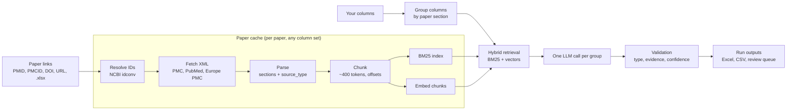

# Paper Column Extractor

Give it a list of papers and the columns you want. It gives you a spreadsheet
with one row per paper and a value in every column. Each value comes with the
sentence it came from, the section, and a confidence score.

- **Your columns, at run time.** Type column names in the app, or load them
  from a JSON file. You do not change any code.
- **Your papers.** Paste PMIDs, PMCIDs, DOIs or PubMed URLs, or upload a
  screening export (`.xlsx`). The app reads full text from PubMed Central
  where it is open access, and the abstract where it is not.
- **Each paper is processed once.** A persistent local cache keeps every
  download, parse, chunk and embedding. A second run, with the same columns
  or with new ones, makes no download and no embedding call.
- **Local by default.** The default model runs locally (Ollama) and the
  default embeddings run locally (sentence-transformers). You need no API
  key. Claude and OpenAI are optional.

> **This repository contains the application only.** It contains no paper
> text, chunks, embeddings or extracted data. Each user builds their own cache
> on their own computer, from their own paper links.
>
> **You are responsible for using the papers you fetch in agreement with their
> terms and licenses.** Open-access articles in PMC carry different licenses,
> and some do not permit text mining or redistribution. The NCBI and Europe PMC
> usage policies also apply. This tool does not check licenses for you.

---

## Architecture



Two storage areas are kept apart:

| Area | What it holds | Keyed by | Default place |
| --- | --- | --- | --- |
| **Paper cache** | raw XML, parsed sections, chunks, BM25, vectors | paper | `~/.paper-extractor/cache` |
| **Runs** | extracted values, review queue, Excel and CSV files | run ID | `./runs` |

A change to your columns starts a new run. It never touches the paper cache.

---

## Quickstart

You need Python 3.11 to 3.13 and, for the default local model,
[Ollama](https://ollama.com).

```bash
git clone https://github.com/NishuSingh28/Bio_Paper_extraction.git paper-column-extractor
cd paper-column-extractor

python -m venv .venv
source .venv/bin/activate            # Windows: .venv\Scripts\activate
pip install -r requirements.txt

cp .env.example .env                 # then edit .env: at least NCBI_EMAIL
                                     # optional: PAPER_CACHE_DIR in Google Drive

ollama pull qwen2.5:7b               # once; keep `ollama serve` running

streamlit run app.py
```

The app opens in your browser. Then:

1. **Columns:** type the columns you want, or load a template.
2. **Papers:** paste your links, or upload a list or a workbook.
3. **Run:** start with a few papers to check the output.
4. **Results:** read the table and the review queue, and download the Excel file.

To keep the paper cache in Google Drive and reuse it on every computer, see
[Keep the cache in Google Drive](#keep-the-cache-in-google-drive).

The first run downloads the small embedding model (`all-MiniLM-L6-v2`, about
90 MB) one time.

### Command line

The CLI is better for long, unattended runs. It uses the same cache and the
same run folders as the app.

```bash
# your columns, your links (one PMID, PMCID, DOI or URL per line)
python cli.py run -c templates/rodent_virus_example.json -l my_links.txt

# papers from a screening export
python cli.py run -c my_columns.json -i export.xlsx -s "Included" -n 100

# see how the columns will be grouped, and stop
python cli.py plan -c my_columns.json

# list runs, and continue one after a stop
python cli.py runs
python cli.py run --run-id <RUN_ID> -l my_links.txt
```

You can stop a run at any time (Ctrl-C or the Stop button). Run the same
command again to continue. Finished work is not done again.

### Docker (optional)

```bash
cp .env.example .env
docker build -t paper-extractor .
docker run --rm -p 8501:8501 --env-file .env \
  -v "$HOME/.paper-extractor:/data" paper-extractor
```

Then open <http://localhost:8501>. The cache and the runs are in the mounted
`/data` folder. To use Ollama on the host, set
`OLLAMA_HOST=http://host.docker.internal:11434` in `.env`.

---

## Define your own columns

In the app, use the column grid on the **Columns** tab. Only the name is
required. Every other field makes the checks stricter.

| Field | Meaning | Example |
| --- | --- | --- |
| `name` | The header in the spreadsheet | `sample size` |
| `type` | `text`, `integer`, `number`, `boolean`, `categorical`, `date` | `integer` |
| `description` | Tells the model what the column means | `total animals tested` |
| `allowed_values` | Comma-separated list. A value outside it goes to review. | `PCR, Serology, Other` |
| `unit`, `minimum`, `maximum` | Range checks | `0` |
| `pattern` | A regular expression the value must match | `^\d{4}$` |
| `section_hint` | Search this section first (`auto` by default) | `methods` |

Save a column set as a template from the app. A template is a JSON file in
`templates/`. You can also write one by hand and pass it to `cli.py -c`:

```json
{
  "name": "My review",
  "columns": [
    {"name": "sample size", "type": "integer", "minimum": 0},
    {"name": "country of sampling"},
    {"name": "detection method", "type": "categorical",
     "allowed_values": "PCR, Serology, Virus isolation, Other"}
  ]
}
```

Some columns need no model call: `title`, `year`, `journal`, `doi`, `pmid`,
`authors`, `funding source`, `ethics approval`, `conflict of interest`,
`data availability`, `keywords`, and their usual synonyms. They come from the
paper record directly.

---

## The paper cache

### Where it is

The default is `~/.paper-extractor/cache`. Change it in one of these places
(a later one wins):

1. `config.yaml`: `paths.cache_dir`
2. `.env` or the environment: `PAPER_CACHE_DIR=/any/local/folder`
3. The CLI: `--cache-dir /any/local/folder`, or the app sidebar

```bash
python cli.py cache path      # print the folder in use
```

### Keep the cache in Google Drive

Put the cache in your Google Drive. Then it survives a new computer or a new
clone, and every later run reuses it. The app reads and writes a normal local
folder. Google Drive for desktop copies that folder to your Drive. The app needs
no Google login and no credentials.

1. Install [Google Drive for desktop](https://www.google.com/drive/download/)
   and sign in.
2. In its settings, set **My Drive syncing options** to **Mirror files**.
   SQLite needs real local files. "Stream files" keeps only online copies.
3. Set the cache folder in `.env`:

   ```bash
   # macOS
   PAPER_CACHE_DIR=~/Library/CloudStorage/GoogleDrive-you@example.com/My Drive/paper-cache
   # Windows
   PAPER_CACHE_DIR=G:/My Drive/paper-cache
   # Linux (no official client; use a folder that rclone or Insync syncs)
   PAPER_CACHE_DIR=~/GoogleDrive/paper-cache
   ```

4. Make sure that the app uses the folder:

   ```bash
   python cli.py cache path
   ```

On a second computer, do steps 1–3 with the same Drive folder. The second
computer then reuses every paper that the first computer cached.

Obey these rules, because a sync tool cannot merge two SQLite databases:

- Use the cache from **one computer at a time**.
- Stop the app on one computer and wait until Drive shows "up to date". Then
  start the app on the other computer.
- After a sync conflict, run `python cli.py cache verify`. It repairs or
  moves aside the bad entries.

Dropbox and OneDrive work the same way: set `PAPER_CACHE_DIR` to a folder in
the synced directory.

**Do not share your cache folder publicly.** The cache holds the text of the
papers that you fetched. Each user builds a cache from their own links.

### What it holds

```
<cache_dir>/
  manifest.sqlite                                   status, versions, times, checksums
  raw/<shard>/<source>_<id>.xml.gz                  original downloads
  parsed/<shard>/<paper_key>.json.gz                sections, metadata, source_type
  chunks/<chunk_ns>/<shard>/<paper_key>.parquet     text, section, offsets, chunk_id
  bm25/<chunk_ns>/<shard>/<paper_key>.json.gz       keyword index (rebuildable)
  vectors/<chunk_ns>__<embed_ns>/vectors.lance      LanceDB table, keyed by chunk_id
  quarantine/<time>/...                             bad entries that verify moved
```

Before each step, the app checks the cache. It does work only when the entry
is missing or out of date.

| Layer | Rebuilt when |
| --- | --- |
| raw | never, if it exists. A "not found" answer is asked again after 7 days (`miss_retry_days`). |
| parsed | the parsed layer is reset |
| chunks, BM25 | the paper text changes (content hash), or the chunker version or chunk size changes (new `chunk_ns`) |
| vectors | the chunks change, or the embedding provider, model or revision changes (new `embed_ns`) |

A namespace holds one chunker or one embedding model. A change writes to a new
namespace, and the old one stays valid. **Vectors from two models are never
mixed.** If the weights behind a model name change, the app detects it from a
fingerprint and stops, and asks you to set `embedding_revision`.

Each run logs its cache hits and misses, its embedding calls and its network
requests, for example:

```
cache parsed  hits 50  misses 0
cache chunks  hits 50  misses 0
embedding calls 0 (0 chunks), query encode calls 0, network requests 0
```

The same numbers are in the **Run info** sheet of the Excel file.

### Safe writes

Every file is written to a temporary name and then renamed. The manifest row
is written after the rename. If a run stops in the middle, each entry is
complete or missing, never half-written. A missing entry is built again on the
next run.

### Maintenance

```bash
python cli.py cache stats                     # papers and bytes per layer
python cli.py cache verify                    # check every checksum; repair or quarantine
python cli.py cache verify --no-repair        # report only
python cli.py cache compact                   # merge vector fragments, vacuum the manifest
python cli.py cache reset --layer embeddings  # delete vectors only (and nothing below)
python cli.py cache reset                     # delete the whole cache
python cli.py cache import-raw old/raw        # import downloads from an older cache folder
```

`verify` rebuilds bad chunk and BM25 files from the parsed text. It moves a bad
raw file, a bad parsed file or a bad vector set to `quarantine/`, so the next
run builds it again. Run `compact` after very large runs.

To reset the cache by hand, stop the app and delete the cache folder.

---

## Configuration

`config.yaml` holds the defaults. `.env` overrides them. Put secrets in `.env`
only.

| Setting | Default | Notes |
| --- | --- | --- |
| `cache_dir` | `~/.paper-extractor/cache` | env `PAPER_CACHE_DIR` |
| `runs_dir` | `runs` | env `PAPER_RUNS_DIR` |
| `backend` / `model` | `ollama` / `qwen2.5:7b` | env `LLM_BACKEND`, `LLM_MODEL` |
| `embedding_provider` / `embedding_model` | `sentence_transformers` / `all-MiniLM-L6-v2` | env `EMBEDDING_PROVIDER`, `EMBEDDING_MODEL` |
| `chunk_target_tokens`, `chunk_overlap_tokens` | 400, 80 | a change makes a new chunk namespace |
| `top_k`, `token_budget` | 12, 2600 | passages per model call |
| `batch_size` | 200 | papers in memory at one time |
| `extract_workers`, `fetch_workers` | 2, 6 | concurrency |
| `confidence_threshold` | 0.6 | below this, a value goes to review |

API keys: `ANTHROPIC_API_KEY`, `OPENAI_API_KEY`, `NCBI_API_KEY`. The app never
writes a key into a run folder.

---

## Extend it

### Add an LLM backend

A backend is a class with one method, `complete_json(system, user, schema)`,
that returns an `LLMResult`.

1. Subclass `llm.BaseLLM` (see `providers.py` for the Claude and OpenAI ones).
2. Implement `complete_json`, and `warmup` and `describe` if useful.
3. Add a branch for your backend name in `llm.build_llm`, and add the name to
   `llm.BACKENDS`.
4. Set `backend: your_name` in `config.yaml` or `LLM_BACKEND` in `.env`.

### Add an embedding provider

1. Subclass `embedder.Embedder`. Set `provider = "your_name"`.
2. Implement `_load()` (set `self.dim`) and `_encode(texts, batch_size)`
   (return a float array, one row per text).
3. Optionally implement `installed()`, a cheap check that the provider can run.
4. Call `embedder.register_provider("your_name", YourClass)`, for example at
   the end of `embedder.py`.
5. Set `embedding_provider: your_name` in `config.yaml`.

The cache gives the new provider its own namespace. Your existing vectors stay
valid for the old provider.

---

## How extraction works

- **Columns are grouped.** Each column is routed to the paper section most
  likely to answer it, by cue terms and embedding similarity. One model call
  answers one group. The section is a search preference, never a filter.
- **Retrieval is hybrid.** BM25 matches exact terms (`IL-6`, `0.5 mg`).
  Embeddings match meaning. Reciprocal rank fusion combines them. Tables get
  their own chunks. Reference lists are dropped.
- **Python checks every answer.** The type, the allowed values, the range and
  the pattern are checked. The evidence quote must be in the passages that the
  model saw. The final confidence is the model's confidence multiplied by what
  the checks found.
- **Nothing is dropped.** A paper with no text still gets `Not stated` in each
  column, and the value goes to the review queue.

| Output sheet | Contents |
| --- | --- |
| `Extraction` | One row per paper, your columns in your order |
| `Evidence` | One row per value: evidence, section, confidence, flags |
| `Review queue` | The values a person should read |
| `Papers` | Per paper: identifiers, full text or abstract, chunks, cost, errors |
| `Run info` | Columns, settings and cache counts, to reproduce the run |

Review flags: `not_found`, `failed_validation`, `missing_evidence`,
`unverified_evidence`, `low_confidence`, `thin_retrieval`,
`abstract_only_gap`, `type_mismatch_soft`.

---

## Tests

```bash
pip install -r requirements-dev.txt
pytest
```

The cache tests use no network and no real model. They prove that:

- a second run over the same papers makes zero embedding calls and zero
  network requests;
- a change of columns reuses every cached layer;
- a change of embedding model or chunk size writes to a new namespace;
- an interrupted write, or a crash between the vector commit and the manifest,
  does not corrupt the cache;
- `verify` repairs or quarantines damaged entries.

CI runs the tests on every push and fails if a data file is committed.

## Files

| File | Role |
| --- | --- |
| `app.py` | Streamlit app |
| `cli.py` | Command line: `run`, `plan`, `runs`, `cache ...` |
| `column_pipeline.py` | Settings, paths and wiring shared by the app and the CLI |
| `cache.py` | The paper cache: manifest, layers, LanceDB vectors, verify, reset |
| `fetch.py` | Identifier parsing, NCBI and Europe PMC, rate limits |
| `chunking.py` | PMC and PubMed XML to sections, then to chunks |
| `index.py` | BM25 and hybrid retrieval for one paper |
| `embedder.py` | Embedding providers |
| `columns.py`, `grouping.py`, `sections.py` | Column specs, routing, section vocabulary |
| `extract_columns.py`, `validate.py` | Model calls and checks |
| `runner.py`, `runstore.py`, `export.py` | Batch execution, run storage, output sheets |
| `llm.py`, `providers.py` | LLM backends |
| `excel_io.py` | Reading a workbook of papers |

## License

MIT. See `LICENSE`. The license covers this code only. It does not cover any
paper you fetch with it.
